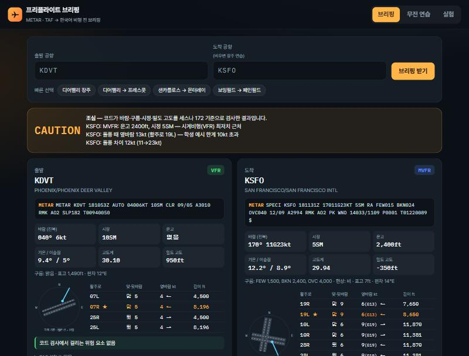
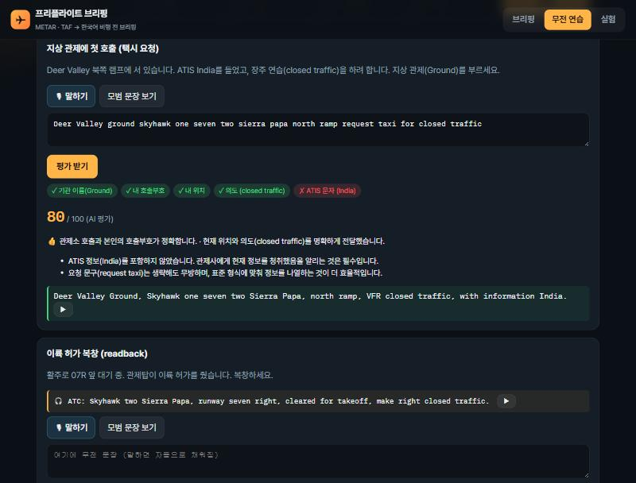
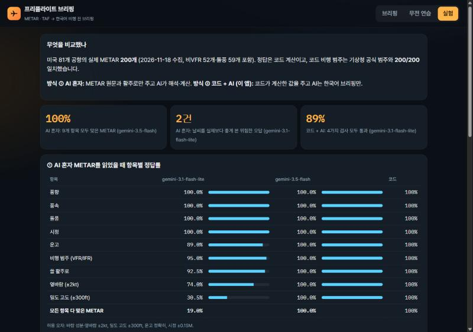

# 프리플라이트 브리핑

> 학생 조종사용 비행 전 브리핑. 실제 METAR·TAF를 **코드가 계산**하고 **AI(Gemini)가 한국어로 설명**하며, 무전 연습까지.

AI 에이전트 3기 Main Quest 2 시제품(PoC)입니다.

- **배포 주소:** https://preflight-brief.onrender.com (첫 접속은 서버가 깨어나느라 50초쯤 걸릴 수 있습니다)
- [문제 정의서](problem.md) · [모델 선정 근거](model-selection.md) · [검증 보고서](evaluation/report.md)



## 한 줄로

METAR를 AI에 통째로 맡기면 숫자를 틀립니다(아래 실험). 그래서 **계산은 코드, 해석은 AI, 검사는 다시 코드**로 나눴습니다.

## 무엇을 하나

| 탭 | 기능 | 누가 하나 |
|---|---|---|
| 브리핑 | 출발·도착 공항의 실제 METAR·TAF 받기 (aviationweather.gov) | 코드 |
| | 비행 범주(VFR·MVFR·IFR·LIFR), 운고, 활주로별 맞바람·옆바람(자북 보정), 돌풍 옆바람, 밀도 고도 | 코드 |
| | **훈련기 7종** 중 고른 기체의 시연 최대 옆바람과 **내 옆바람 한계**로 위험 요소와 판정 GO / CAUTION / NO-GO | 코드 |
| | 한국어 브리핑: 판정 이유, 바람·구름·성능·도착지·예보 설명, 조심할 점, 스스로 확인할 질문 | **AI** |
| | **숫자 검사:** AI 글에 계산·원문에 없는 숫자가 나오면 경고 | 코드 |
| | 이어서 물어보기 (계산 결과를 근거로 답, 다음 질문 제안) | **AI** |
| 무전 연습 | 실제 날씨로 만든 ATIS를 음성으로 듣고 받아쓰기 → 채점 | 코드 |
| | 지상 호출·이륙 허가 복창·다운윈드 보고: 마이크로 말하면(브라우저 음성 인식) 필수 항목 검사 + 피드백·고친 문장 | 코드 + **AI** |
| 실험 | 실제 METAR 200개로 "AI 혼자" 대 "코드 + AI" 비교 결과와 실패 사례 | — |

| 무전 연습 | 실험 결과 |
|---|---|
|  |  |

### 훈련기 7종

| 기체 | 시연 최대 옆바람 | 무전 호출 |
|---|---|---|
| Cessna 152 | 12kt | Cessna |
| Cessna 172S Skyhawk (기본) | 15kt | Skyhawk |
| Cessna 182T Skylane | 15kt | Skylane |
| Piper PA-28-181 Archer | 17kt | Archer |
| Diamond DA40 Diamond Star | 20kt | Diamond Star |
| Cirrus SR20 | 20kt | Cirrus |
| Piper PA-44-180 Seminole (다발기) | 17kt · Vmc 56kt · Vyse 88kt | Seminole |

시연 최대 옆바람은 POH 공개 수치(한계가 아니라 시험된 값)이고 연식마다 다를 수 있습니다. 내 옆바람 한계(기본 10kt)와 기체 번호는 화면에서 바꾸며, 무전 연습의 호출부호도 따라 바뀝니다.

## 검증 결과 요약

자세한 내용은 [evaluation/report.md](evaluation/report.md)와 앱의 **실험** 탭에 있습니다.

<!-- RESULTS -->
실제 METAR 200개(미국 81개 공항, VFR 아래 52개, 돌풍 59개). 코드의 비행 범주는 기상청 공식 범주와 **200/200** 일치해서 코드 계산을 정답으로 썼다.

- **100%** — AI 혼자: 9개 항목 모두 맞은 METAR (gemini-3.5-flash)
- **2건** — AI 혼자: 날씨를 실제보다 좋게 본 위험한 오답 (gemini-3.1-flash-lite)
- **89%** — 코드 + AI: 4가지 검사 모두 통과 (gemini-3.1-flash-lite)

**AI 혼자 해석 (METAR 200개, 코드 계산이 정답)**

| 항목 | gemini-3.1-flash-lite | gemini-3.5-flash |
|---|---|---|
| 풍향 | 100% | 100% |
| 풍속 | 100% | 100% |
| 돌풍 | 100% | 100% |
| 시정 | 100% | 100% |
| 운고 | 89% | 100% |
| 비행 범주 (VFR/IFR) | 95% | 100% |
| 쓸 활주로 | 92.5% | 100% |
| 옆바람 (±2kt) | 74% | 100% |
| 밀도 고도 (±300ft) | 30.5% | 100% |
| **9개 모두 맞음** | **19%** | **100%** |
| 날씨를 좋게 본 위험 오답 | 2건 | 0건 |
| 채점한 METAR 수 | 200 | 200 |

**코드 + AI 브리핑 검사**

| 검사 | gemini-3.1-flash-lite | gemini-3.5-flash |
|---|---|---|
| 숫자가 모두 계산값과 일치 | 96.5% | 100% |
| VFR 아래 날씨면 비행 범주 언급 | 92% | 100% |
| 위험 요소 빠짐없이 언급 | 100% | 100% |
| 판정을 뒤집지 않음 | 100% | 100% |
| **4가지 모두 통과** | **88.5%** | **100%** |
| (참고) VFR 날씨까지 범주를 말함 | 53.5% | 100% |
| 채점한 브리핑 수 | 200 | 20 |

**속도·비용** (실험은 METAR 10~20개를 한 번에 묶어 보냈다. 앱의 브리핑 1번은 공항 2곳이라 lite 기준 3~5초)

| | gemini-3.1-flash-lite | gemini-3.5-flash |
|---|---|---|
| AI 호출 수 (묶음) | 30 | 11 |
| 호출 1번 평균 시간 | 5.5초 | 116.1초 |
| 사용 토큰 합계 | 92,845 | 172,706 |
<!-- /RESULTS -->

## 구조

```
브라우저 (public/: 빌드 없음)
   ├ lib/core.js   계산 엔진 (비행 범주·바람 성분·밀도 고도·위험 요소·숫자 검사) — 서버와 공유
   ├ lib/radio.js  ATIS 문장·무전 상황·필수 항목 검사 — 서버와 공유
   └ app.js        화면, 음성 읽기(speechSynthesis)·음성 인식(SpeechRecognition)
        │ fetch /api/…
        ▼
Express 5 서버 (server.js)
   ├ src/wx.js       aviationweather.gov METAR·TAF·공항 정보 (5분 캐시)
   ├ src/prompts.js  지시문 + JSON 스키마
   └ src/gemini.js   Gemini API (JSON 모드), 키는 환경변수만
scripts/collect.js   실험용 METAR 200개 모으기 → data/metars.json
scripts/eval.js      두 모델 × 두 방식 실험 → evaluation/results/
```

| 방법 | 주소 | 하는 일 |
|---|---|---|
| GET | `/api/brief?dep=KDVT&arr=KPRC` | 코드 계산 결과, 판정, 무전 상황 (AI 안 씀) |
| POST | `/api/brief/ai` | AI 브리핑 + 숫자 검사. 서버가 기상을 다시 받아 계산한 값만 AI에 넘김 |
| POST | `/api/ask` | 이어서 질문 |
| POST | `/api/radio` | 무전 평가 (필수 항목 코드 검사 + AI 피드백) |
| GET | `/api/lab` | 실험 결과 |

AI 요청은 IP당 1분에 6번으로 막아 무료 한도를 보호합니다. AI가 실패하면 꾸민 답 없이 오류를 알리고, 코드 계산 결과는 그대로 씁니다.

## 실행

필요: Node 20.12 이상, [Google AI Studio](https://aistudio.google.com/apikey)의 Gemini API 키(무료).

```bash
npm install
cp .env.example .env      # GEMINI_API_KEY= 뒤에 키를 넣기
npm start                 # http://localhost:3000
npm test                  # 시험 14개 (외부 호출 없음)
```

실험 다시 돌리기:

```bash
node scripts/collect.js         # 새 METAR 200개 (선택)
node scripts/eval.js            # AI 호출, 무료 한도라 20~40분
node scripts/eval.js --score    # 저장된 AI 답으로 다시 채점만
```

## 한계

- 연습·학습용입니다. 실제 비행 결정은 공식 브리핑(1800wxbrief), POH, 교관과 함께 하세요.
- 활주로 자방위는 활주로 번호×10으로 근사합니다. 기체 수치는 대표 POH 값이라 실제 기체의 POH를 따르세요.
- NOTAM·TFR·AIRMET·SIGMET은 다루지 않습니다.
- 음성 인식은 브라우저 기능(Chrome·Edge)이라 소리를 글자로 바꾸는 일은 브라우저 회사의 음성 인식 서비스가 합니다. 이 앱 서버에는 글자만 오고 저장하지 않습니다.
- Gemini 무료 한도라 사람이 몰리면 잠시 AI가 쉬어야 할 수 있습니다.
